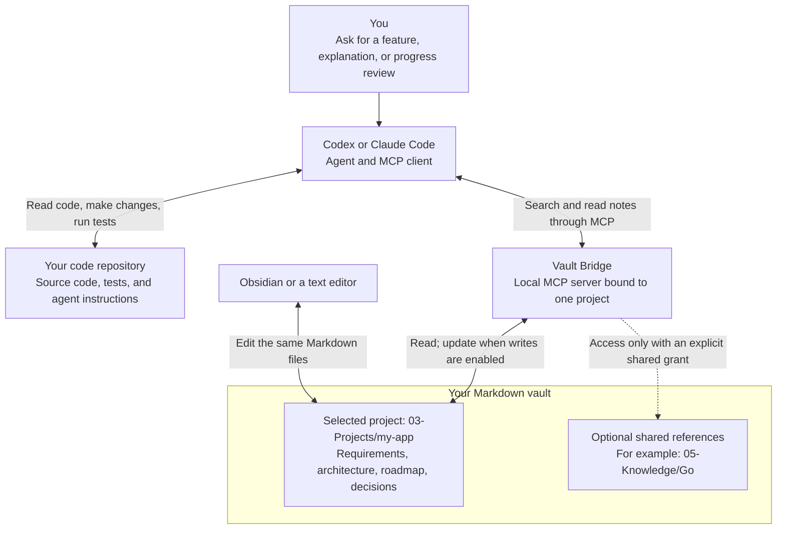

# Vault Bridge

**Connect your coding agent to the project knowledge in your Markdown vault.**

Vault Bridge lets Codex or Claude Code find and read the plans, requirements,
and decisions you keep in Obsidian or ordinary Markdown files. Your agent can use
those notes while working in your code repository. With writes enabled, it can
also record verified progress back in the vault.

Use it when your project knowledge lives outside your source repository and you
want it available in coding sessions without copying notes into each prompt.
You keep editing the same files; the bridge reads their current saved contents.

[How it works](#how-it-works) · [Quick start](#quick-start) ·
[Use cases and prompts](docs/use-cases.md) · [Full setup](docs/setup.md)

## How it works

You talk to **Codex or Claude Code**. That client starts **Vault Bridge** locally
and makes its tools available to the agent through MCP (Model Context Protocol).
The agent uses the bridge to consult your notes and its normal coding tools to
work on your repository.



1. **Connect once.** Run `install` to save the project connection and add guidance
   to your repository's `AGENTS.md` or `CLAUDE.md`. The installer checks that the
   saved server command can start and retrieve notes.
2. **Ask for work.** In a new coding session, the client starts the bridge. The
   agent can search and read relevant notes, then use them while changing code.
3. **Keep the record current.** Edit notes yourself, or enable `--allow-writes`
   so the agent can update them after checking the work. Note updates check the
   saved revision to avoid overwriting a newer edit.

Each bridge process stays bound to one project. Shared folders require explicit
`--shared` grants. **Access is read-only by default.** The bridge exposes Markdown
notes; code edits and test runs happen through your agent's other tools.

The bridge runs locally, while your coding client controls which retrieved
content it sends to its model provider. Installing a connection makes the tools
available; the agent chooses which notes to read for each task. See the
[detailed request flow](docs/how-it-works.md) and [access boundaries](docs/reference.md#security-boundaries).

### A feature request, from notes to code

Suppose your vault contains password-reset requirements and an authentication
decision record. In your coding client, ask:

```text
Use devvault to read the password-reset requirements and authentication decisions.
Implement the feature in this repository and run the relevant tests. Cite the
notes you used and report what you verified.
```

The agent retrieves the notes through Vault Bridge, inspects the current code,
and implements the change in your repository. With writes enabled, the generated
agent guidance also asks it to update affected project notes with the outcome.
The tests and recorded evidence determine what can be marked complete.

## What you can use it for

| When you want to… | Ask your agent to… |
| --- | --- |
| Resume a project after a break | Read the overview and roadmap, then identify the next unfinished milestone. |
| Implement a feature | Read its requirements and relevant decisions before proposing code changes. |
| Understand an earlier choice | Search the decision records and cite the notes that explain it. |
| Check progress | Compare the roadmap with code and test evidence, then report the gaps. |
| Reuse knowledge across projects | Consult a shared folder you explicitly granted, such as `05-Knowledge/Go`. |
| Keep plans current after shipping | Update the relevant notes with verified results when writes are enabled. |

See [ready-to-paste prompts](docs/use-cases.md) for each workflow.

If all your documentation already lives in the repository and your agent reads
it directly, you may not need a separate bridge. Obsidian is optional; the vault
is a folder of Markdown files with projects under `03-Projects/`.

## Quick start

Start by connecting **one code repository to one project's notes**. You need
Go 1.25+, `make`, this checkout, and an installed, signed-in Codex or Claude Code
client. These commands target macOS and Linux.

### 1. Build and choose your folders

Clone the repository if you do not have it yet:

```sh
git clone https://github.com/jsainthilaire/vault-bridge.git
cd vault-bridge
```

From the checkout, build the executable and replace the example paths below.
Use the same terminal for the remaining commands:

```sh
make build
BRIDGE_PATH="$PWD/.bin/vault-bridge"
VAULT_PATH="/absolute/path/to/DevVault"
CODE_REPO="/absolute/path/to/my-app"
PROJECT_ID="my-app"
```

Keep these locations separate:

| Variable | Points to | Example |
| --- | --- | --- |
| `BRIDGE_PATH` | The executable your coding client will launch | `vault-bridge/.bin/vault-bridge` |
| `CODE_REPO` | Your existing source repository, where you use the agent | `my-app/` |
| `VAULT_PATH` | The Markdown vault containing `03-Projects` | `DevVault/` |
| `PROJECT_ID` | The selected project's folder name inside `03-Projects` | `my-app` |

For example, the notes and source code can live side by side:

```text
work/
  vault-bridge/                   # This tool's source and executable
  my-app/                         # Your project's code and tests
  DevVault/                       # Open this folder in Obsidian, if you use it
    03-Projects/
      my-app/                     # Your project's notes
        index.md
        requirements.md
        roadmap.md
```

Use a lowercase kebab-case ID, such as `my-app`. Your code folder can have a
different name. Keep the executable at its registered location; see
[installing it in a stable location](docs/setup.md#2-build-the-bridge-and-choose-your-paths).

**If you already have project notes, skip initialization.** Otherwise, create
planning templates before connecting:

```sh
"$BRIDGE_PATH" vault init --path "$VAULT_PATH" \
  --id "$PROJECT_ID" --title "My App"
```

Initialization adds missing files and preserves existing notes. Fill in the
project overview in `index.md` and the requirements you want your agent to use.
The templates provide structure; they do not discover your project's requirements.
See [what belongs in each note](docs/how-it-works.md#where-files-belong).

### 2. Connect your coding client

```sh
"$BRIDGE_PATH" install "$CODE_REPO" --client codex \
  --target "$VAULT_PATH/03-Projects/$PROJECT_ID"
```

Use `--client claude` for Claude Code. Run once for each client if you use both.
The installer:

- Saves the `devvault` connection in the repository's client settings.
- Adds a managed workflow to `AGENTS.md` or `CLAUDE.md`, preserving other content.
- Checks MCP startup, available tools and index retrieval through the SDK.

**Access starts read-only.** Installation creates no vault notes. The SDK check
verifies the saved server command; the next step verifies your coding client.

### 3. Start a new session and try it

Open your coding client in `CODE_REPO`, complete its trust and connection approvals,
and use the verification prompt printed by the installer. For `my-app`, it is:

```text
Use only the devvault MCP tools for this check. Call project_context and confirm
the project is my-app, then read 03-Projects/my-app/index.md.
Report the source path and actual result. Do not edit files or use shell or
filesystem tools as a fallback if MCP is unavailable.
```

Replace `my-app` if you chose another ID. A successful tool call with the correct
project and source path confirms retrieval. Then try a useful task:

```text
Use devvault to read this project's requirements and roadmap.
Summarize the goal, the open work, and the next useful task, with source paths.
Do not change any files yet.
```

The client starts Vault Bridge automatically; you do not need to run `serve` in
another terminal. If retrieval fails, follow [Troubleshooting](docs/troubleshooting.md).

## Choose your next step

| You want to… | Setup |
| --- | --- |
| Add notes for another project | [Initialize a project](docs/setup.md#3-initialize-missing-vault-or-project-files) |
| Let the agent maintain project notes | [Enable writes](docs/setup.md#enable-project-writes-and-update-milestones) with `--allow-writes` |
| Share reusable references | [Grant shared folders](docs/setup.md#share-knowledge-folders) with `--shared` |
| Connect projects that match source-folder names | [Bulk source matching](docs/setup.md#match-vault-projects-to-source-folders) |
| Register all projects in a vault | [Bulk global installation](docs/setup.md#install-every-project-globally) |
| Use custom limits or project mappings | [YAML configuration](docs/reference.md#configuration) |
| Change or remove an existing connection | [Connection maintenance](docs/setup.md#update-or-remove-a-connection) |

With `--allow-writes`, the agent can create and update Markdown in the selected
project and folders explicitly granted with `--shared`. Updates check the note's
revision to avoid replacing a newer edit. Legacy YAML `shared_read_paths` remain
read-only unless also covered by `--shared`.

For example, when installing a new connection with Go references and note updates:

```sh
"$BRIDGE_PATH" install "$CODE_REPO" --client codex \
  --target "$VAULT_PATH/03-Projects/$PROJECT_ID" \
  --shared 05-Knowledge/Go --allow-writes
```

The shared folder must already exist. For an existing read-only connection, follow
[the write-enablement steps](docs/setup.md#enable-project-writes-and-update-milestones)
before changing launch options. Rerunning install can add shared grants, but it
does not silently replace a connection with different write permissions.

Bulk installations create `devvault-<project-id>` connections in user settings.
All registered connections are available across repositories; each keeps its own
project scope. Source matching selects connections to install, not which server
the client can use in a given repository.

## Documentation

| Guide | What you will find |
| --- | --- |
| [Use cases](docs/use-cases.md) | Everyday workflows, prompts and expected results |
| [Setup](docs/setup.md) | Client configuration, bulk connections, optional writes and maintenance |
| [How it works](docs/how-it-works.md) | Startup diagrams, file layout and project scope |
| [Reference](docs/reference.md) | Commands, flags, MCP tools and resource limits |
| [Troubleshooting](docs/troubleshooting.md) | Connection, path and write errors |
| [Development](docs/development.md) | Tests and SDK verification helpers |

For examples in your terminal, run `.bin/vault-bridge --help` or
`.bin/vault-bridge install --help`.

## Licence

Vault Bridge is free and open source under the [MIT licence](LICENCE).
Anyone may use, modify and redistribute it, including commercially, as long as
the copyright and permission notice is retained. See the licence for full terms.
