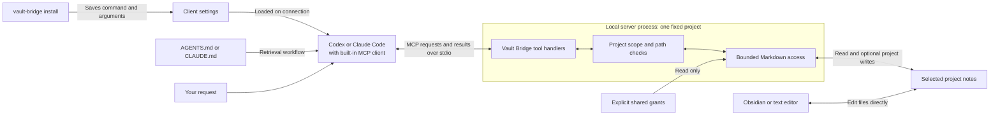
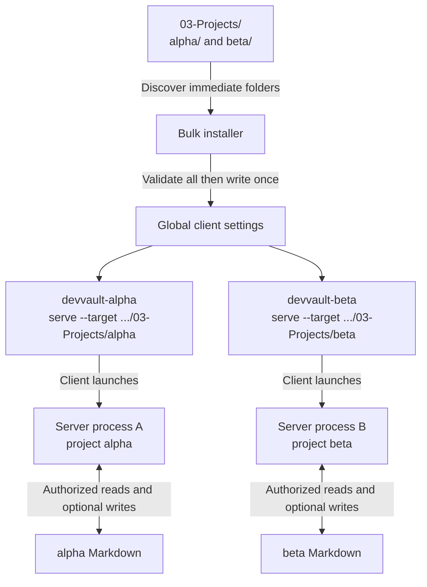

# How Vault Bridge works

Vault Bridge lets a coding agent consult project knowledge that lives outside
its code repository. You keep ordinary Markdown notes, edit them in Obsidian or
another editor, and choose exactly which project the bridge may serve.

- [Components](#components)
- [Request flow](#request-flow)
- [Automatic startup and tool discovery](#automatic-startup-and-tool-discovery)
- [How bulk global connections work](#how-bulk-global-connections-work)
- [Where files belong](#where-files-belong)
- [Everyday use](#everyday-use)
- [Paths and shared knowledge](#paths-and-shared-knowledge)
- [Updating notes and milestones](#updating-notes-and-milestones)
- [Lifecycle and common questions](#lifecycle-and-common-questions)

For installation commands, use [Setup](setup.md). For all arguments and limits,
use [Reference](reference.md).

## Components

Codex or Claude Code is the application you interact with. Its built-in MCP
client connects to Vault Bridge. The agent chooses tools through that application;
Vault Bridge runs the requested file operations and returns the results.

| Component | Responsibility | Where it lives |
| --- | --- | --- |
| Installer (`vault-bridge install`) | Validates the selected notes and saves a launch command in the chosen client's settings, then exits. | The executable you built or installed |
| Client settings | Record the executable, `serve` arguments and server name. | Repository or user configuration; see [locations](setup.md#where-to-run-the-server) |
| Codex or Claude Code | Hosts the conversation, manages MCP connections and applies client tool permissions. | Your coding client |
| Agent/model | Chooses relevant tools and uses their results to answer or implement your request. | The client's model session |
| Vault Bridge server (`vault-bridge serve`) | Exposes tools, binds one project at launch, checks paths and returns bounded results. | A local child process started by the client |
| Markdown vault | Holds project plans, decisions and optional shared knowledge. | Ordinary files on disk, editable in Obsidian or another editor |
| Code repository and instructions | Hold implementation and the retrieval workflow in `AGENTS.md` or `CLAUDE.md`. | The repository where you work |

The same executable provides installation and serving. An installer invocation
finishes after saving configuration; a serving invocation stays connected to its
client. The installer records its own executable's resolved absolute path, so
run installation from the copy you intend to keep.

## Request flow

MCP, the Model Context Protocol, lets a client discover tools and call them on
behalf of an agent. Vault Bridge provides the knowledge tools; Codex or Claude
Code is the client that makes them available in your conversation.



The client starts the executable specified in its MCP settings. At startup, the
bridge validates the selected project folder and resource limits. A request can
then read, list or search only that project and explicitly granted shared topics.
Tool arguments cannot switch the process to another project.

Each request uses the vault's files directly. Search is local case-insensitive
substring/token matching. There is no copied knowledge store, indexing service,
embedding database or background synchronization to maintain.

The bridge runs locally and sends results back over stdio. Your coding client
uses its own model connection and data policies; a local bridge does not make
the model session offline. Vault Bridge itself needs no service API key.

## Automatic startup and tool discovery

After installing a connection, start a new Codex or Claude Code session and
complete any applicable trust or server approval prompts. The client reads the
saved `command` and `args` and launches Vault Bridge as a child process when it
opens the MCP connection. You do not need a separate server terminal. This is the
standard [MCP stdio transport](https://modelcontextprotocol.io/specification/2025-11-25/basic/transports#stdio):
the client writes protocol messages to the child's stdin and reads replies from
its stdout; diagnostics use stderr.

For example, installing `--target /vault/03-Projects/my-app` saves the equivalent
of this launch command, using your actual absolute executable and target paths:

```sh
/path/to/vault-bridge serve --target /vault/03-Projects/my-app \
  --project my-app --transport stdio
```

The client performs the handshake and tool discovery. You only need to install
the connection and use the client; the messages below are handled internally.

```mermaid
sequenceDiagram
    actor User
    participant Client as Codex or Claude Code
    participant Settings as Client settings
    participant Bridge as Vault Bridge child process
    participant Vault as Project Markdown
    User->>Client: Start a new coding session
    Client->>Settings: Load enabled MCP entries
    Settings-->>Client: Executable and fixed project arguments
    Note over User,Client: Complete trust and server approvals when required
    Client->>Bridge: Launch executable with serve arguments
    Bridge->>Bridge: Validate project scope and limits
    Client->>Bridge: initialize
    Bridge-->>Client: Server information and capabilities
    Client->>Bridge: notifications/initialized
    Client->>Bridge: tools/list
    Bridge-->>Client: Tool names, descriptions and schemas
    User->>Client: Read this project's roadmap
    Note over Client: Agent selects tools; client applies permissions
    Client->>Bridge: tools/call project_context
    Bridge->>Vault: Read authorized index
    Vault-->>Bridge: Markdown
    Bridge-->>Client: Project identity and source paths
    Client->>Bridge: tools/call document_read
    Bridge->>Vault: Read authorized roadmap
    Vault-->>Bridge: Markdown
    Bridge-->>Client: Bounded content, revision and source path
    Client-->>User: Answer grounded in the returned notes
    User->>Client: End session
    Client->>Bridge: Close connection and stop child process
```

The initialization exchange follows the
[MCP lifecycle](https://modelcontextprotocol.io/specification/2025-11-25/basic/lifecycle).
Vault Bridge advertises six read tools, plus two project write tools when its
saved launch arguments include `--allow-writes`. A connected process handles
successive calls; installation is not repeated for each question.

**Automatic startup makes tools available; it does not read all your notes.**
The agent chooses calls based on the task, tool descriptions and instructions.
Merge the [knowledge workflow](setup.md#agent-knowledge-workflow) into your
repository's instruction file to make consultation an explicit expectation.
Confirm actual use by inspecting the tool calls and returned source paths.
Installing Vault Bridge does not write those instructions for you.

For client-specific configuration and approval details, see the official
[Codex MCP guide](https://learn.chatgpt.com/docs/extend/mcp) and
[Claude Code MCP guide](https://code.claude.com/docs/en/mcp).
If a connection is missing or failed, inspect `/mcp` and follow
[Troubleshooting](troubleshooting.md); a saved entry alone does not prove that
the process started successfully.

## How bulk global connections work

`install --global --projects-dir /vault/03-Projects --client codex` enumerates
existing project folders once. For `alpha` and `beta`, it saves two entries in
the client's user configuration. Each entry launches the same executable with a
different fixed target:



The client can use both connections from any repository. A call on
`devvault-alpha` can access alpha's notes; accessing beta requires calling
`devvault-beta`. Server identity stays fixed even if a tool argument mentions
another project. Bulk targets grant no shared knowledge access.

| Installation mode | Saved server names | What a client session can access through these entries |
| --- | --- | --- |
| Project-local single project | `devvault` in the code repository | The selected project when that repository's configuration is loaded |
| Global single project | `devvault` in user settings | The same selected project across repositories |
| Global projects directory | `devvault-alpha`, `devvault-beta`, etc. in user settings | Every registered project through its separate connection, across repositories |

Global configuration does not select a server from the current repository name.
With several servers, name the intended connection in repository instructions
and prompts, for example:

```text
Use devvault-alpha for this repository. Call its project_context and verify that
the returned project is alpha, then read 03-Projects/alpha/roadmap.md.
```

New folders are picked up when you rerun bulk installation. Matching entries are
left intact, new projects are added, and entries for removed folders remain
until you remove them. There is no folder watcher. If two vaults have the same
project ID, their `devvault-<id>` names collide; the installer reports a conflict
instead of replacing an entry. See [bulk setup](setup.md#install-every-project-globally)
for validation rules and [connection maintenance](setup.md#update-or-remove-a-connection)
for changing saved entries.

## Where files belong

A typical arrangement is:

```text
work/
  vault-bridge/                    # Build the bridge here
    .bin/vault-bridge
  DevVault/                       # Open this folder in Obsidian
    03-Projects/
      my-project/
        index.md
        vision.md
        requirements.md
        architecture.md
        roadmap.md
        tasks.md
        features/
        decisions/
        research/
        sessions/
    05-Knowledge/
      Go/
  my-project/                     # Start your coding client here
    AGENTS.md                     # Codex instructions
    CLAUDE.md                     # Claude instructions, if used
    .codex/config.toml            # Codex connection, if used
    .mcp.json                     # Claude connection, if used
    ...implementation files...
```

The folders may live elsewhere; the connection stores their absolute paths.
The project ID names the docs scope and can differ from the code directory's
name. The CLI's [initializer](setup.md#3-initialize-missing-vault-or-project-files)
creates the standard notes and directories; it preserves existing authored files.

| Note or collection | Use it for |
| --- | --- |
| `index.md` | Project overview and links returned by `project_context` |
| `vision.md`, `requirements.md` | Goals, constraints and acceptance criteria |
| `architecture.md` | Components, boundaries and important implementation choices |
| `roadmap.md`, `tasks.md` | Milestones, progress and actionable work |
| `features/` | Feature requirements and acceptance evidence |
| `decisions/` | Architectural decision records |
| `research/`, `sessions/` | Findings, sources and records of work actually performed |

Ordinary Markdown works with or without YAML frontmatter. Frontmatter can carry
fields such as `type`, `project`, `status` and `updated`; generated notes provide
examples. Malformed YAML is an error rather than silently ignored metadata.

## Everyday use

Keep the agent instructions in your code repository so new sessions know to
consult the vault. Start with `project_context`, search for relevant topics,
then read the actual source notes before planning or changing code.

Examples to paste into your agent conversation:

```text
Use devvault to read this project's requirements and architecture.
Summarize the constraints relevant to adding password reset, with source paths.
```

```text
Search this project's decisions for authentication. Read the matching ADRs
before proposing a change, and explain which existing decisions apply.
```

```text
Compare the roadmap with the current implementation and test evidence.
List which milestones are complete and which still need verification.
Do not mark SDK tests as proof of a live client connection.
```

These are conversation prompts, not extra CLI commands or built-in slash
commands. Code changes stay in the code repository. Notes remain the editable
source of project plans and decisions. Nothing marks a milestone complete merely
because a test command exits successfully; the agent must assess the evidence.

## Paths and shared knowledge

Read/write `path` arguments are **vault-relative**, while list/search `section`
arguments usually name a **project-relative** subtree:

| Request | Example arguments |
| --- | --- |
| Read the current roadmap | `path: "03-Projects/my-project/roadmap.md"` |
| List feature notes | `section: "features", limit: 5` |
| Search the active project | `query: "authentication"` with section omitted |
| Search a granted Go topic | `query: "context cancellation", section: "shared:05-Knowledge/Go"` |
| Read a granted shared note | `path: "05-Knowledge/Go/context.md"` |

`--target` grants only the selected project and uses default limits. To enable a
shared topic, use a [YAML mapping](reference.md#configuration) with an explicit
`shared_read_paths` entry. The shared selector must match that grant exactly.
Shared content remains read-only even when project writes are enabled.

Each process has one scope. Another code repository can reuse the same binary
with a different launch target. A global connection keeps the same selected
project everywhere; it does not infer identity from the repository you opened.

Bulk global installation with `--projects-dir <vault/03-Projects>` creates one
named connection per immediate project folder (`devvault-<project-id>`). All
those connections are available to the client across repositories. Their server
processes retain separate project scopes; the client can call tools on every
registered connection. Bulk setup validates all projects before one client
settings write and preserves existing matching connections on repeat runs.

## Updating notes and milestones

The default server exposes six read tools. If the trusted launch command
includes `--allow-writes`, it also exposes project Markdown create/update tools.
Clients apply their own tool approval policy. No delete, rename or directory
creation tools are exposed.

After [enabling writes](setup.md#enable-project-writes-and-update-milestones),
you can ask:

```text
Analyze the implementation and tests, then update completed milestones in
this project's roadmap through devvault. Read the complete note and revision
first, preserve unrelated content, and leave unverified work open.
```

The agent reads the complete note, checks `truncated: false`, changes the needed
content, and sends the full replacement with `expected_revision`. Revisions hash
the exact Markdown, including frontmatter. If it changed since the read, the
write fails with `conflict`; the agent must reread and merge its changes.

Writes publish atomically, and bridge processes coordinate through a project
lock. External editors do not honor that lock, so avoid editing the same note
in Obsidian while the agent updates it. These checks are not a filesystem snapshot.

## Lifecycle and common questions

**Do I leave a server running in a terminal?** Your client owns the process and
starts it from the installed connection. A manually started `serve` process
waits for MCP messages; it does not connect itself to another client session.

**Do I need to restart after editing a note?** Subsequent requests read the
vault directly. Restart the client session after changing server arguments,
project targets or client settings. Rebuild and restart after changing bridge code.

**Does install fill in my plans or agent instructions?** It registers the
connection only. Initialization creates missing note structure; you author the
content and merge the [agent workflow](setup.md#agent-knowledge-workflow) into
your repository's instruction file.

**Can I move the binary, vault or code repository?** Settings contain absolute
paths. Update the relevant paths and restart the client. Project-local settings
move with the code repository, but their saved target/binary paths still need to
exist. Global registration and client trust may need checking in the new location.

**Can a teammate reuse my settings?** Each person needs the binary, vault access
and paths valid on their machine. Keep generated settings with personal paths out
of commits; commit portable templates and project instructions instead. Sharing
Markdown through your own version control or file service is separate from the
bridge.

**Does this prevent all other access to my files?** Scope checks apply to bridge
tools. The agent's own shell and filesystem tools follow separate OS and client
permissions. See [Security boundaries](reference.md#security-boundaries).
